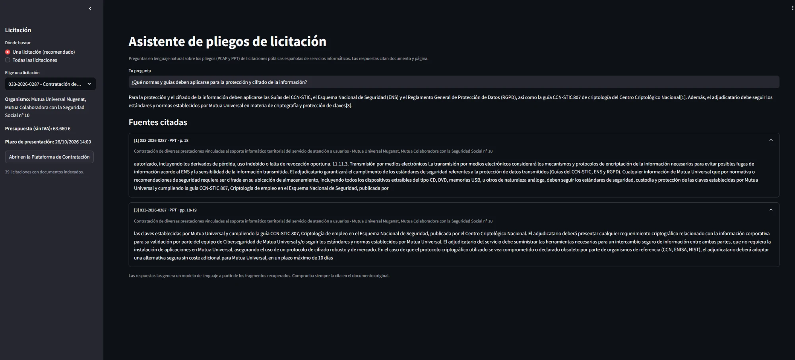
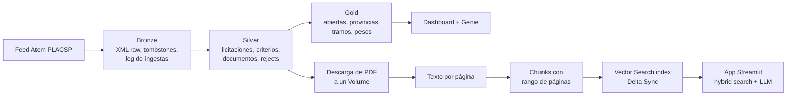
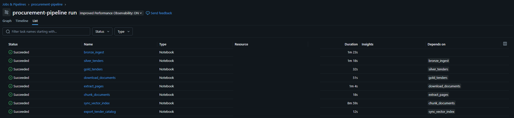
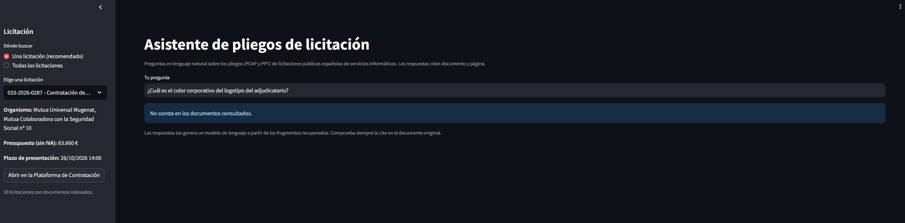
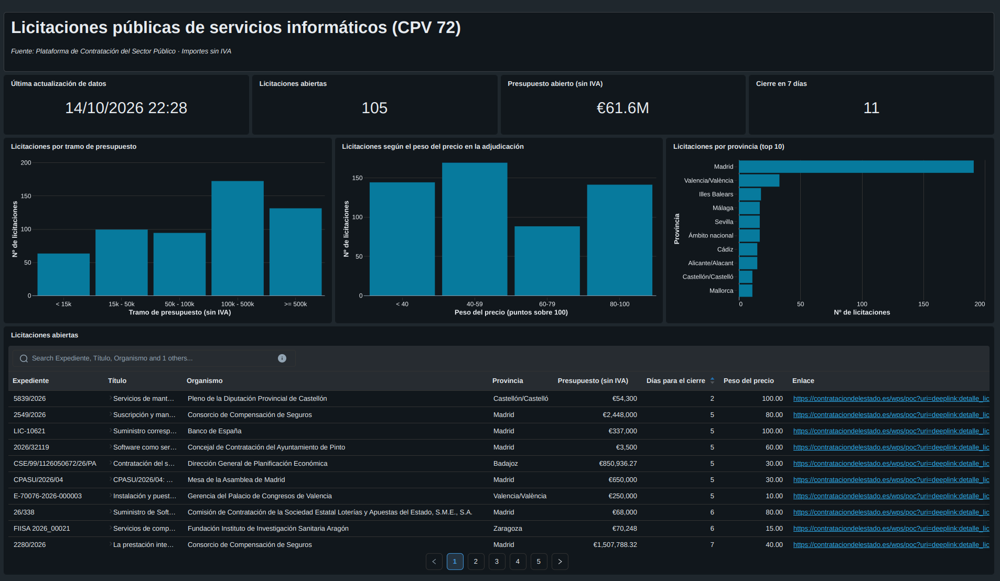
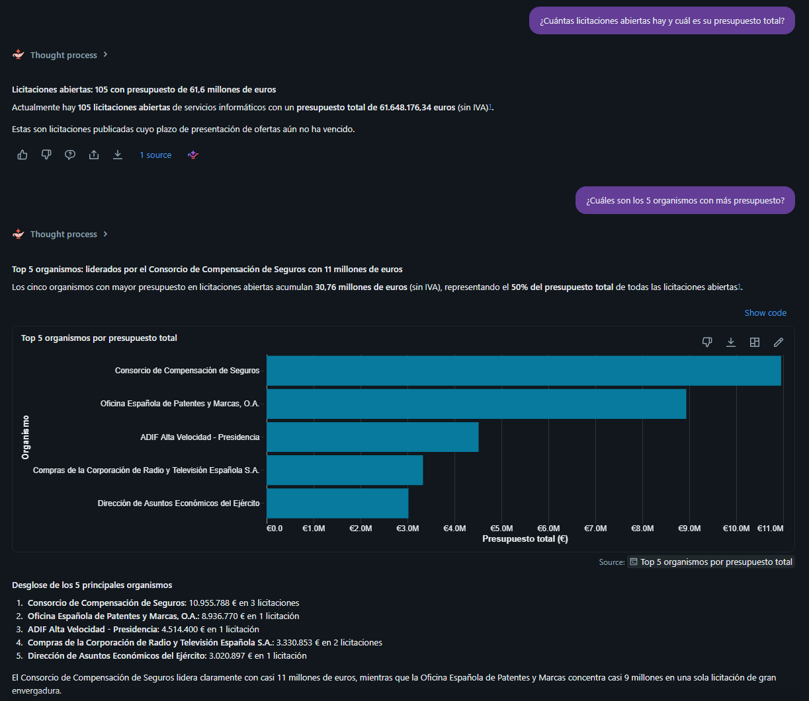

# Public Procurement Intelligence


Lakehouse en Databricks sobre licitaciones públicas españolas de servicios
informáticos: ingesta diaria del feed oficial, capas Bronze/Silver/Gold,
dashboard, Genie y un asistente que responde preguntas sobre los pliegos con
cita de documento y página.



## Resumen

Este proyecto recorre un producto de datos completo sobre una fuente real:
ingesta incremental de un feed Atom con XML anidado, versiones repetidas y
tombstones, modelado en capas, analítica para directivos y un sistema de
búsqueda y respuesta sobre los documentos de cada licitación.

El pipeline lee el feed de la Plataforma de Contratación del Sector Público,
guarda cada entrada como XML sin tocar, la convierte en tablas tipadas con
data quality y versiones, y publica un dashboard y un Genie space. En paralelo
descarga los pliegos de las licitaciones abiertas (el PCAP, de cláusulas
administrativas, y el PPT, de prescripciones técnicas), los divide en chunks
conservando la página, los indexa en Databricks Vector Search y los expone en
una Databricks App que **cita la fuente de cada respuesta y se niega a
contestar cuando los documentos no la contienen**.

Todo corre en Databricks Free Edition y se despliega como código con un Asset
Bundle.

**Tabla de contenidos**

- [Problema](#problema)
- [Solución](#solución)
- [Stack técnico](#stack-técnico)
- [Decisiones de diseño](#decisiones-de-diseño)
- [Fuente de datos](#fuente-de-datos)
- [Recorrido por las capas](#recorrido-por-las-capas)
- [Pipeline de documentos y RAG](#pipeline-de-documentos-y-rag)
- [Evaluación del retrieval](#evaluación-del-retrieval)
- [Dashboard y Genie](#dashboard-y-genie)
- [Asistente de pliegos](#asistente-de-pliegos)
- [Operación](#operación)
- [Aprendizajes y retos](#aprendizajes-y-retos)
- [Limitaciones actuales](#limitaciones-actuales)
- [Ejecución](#ejecución)
- [Calidad y CI](#calidad-y-ci)
- [Costes](#costes)
- [Estructura del repositorio](#estructura-del-repositorio)
- [Qué demuestra este proyecto](#qué-demuestra-este-proyecto)

## Problema

La contratación pública publica miles de licitaciones, pero la información útil
está repartida en dos sitios que no se parecen:

- Un feed estructurado (XML CODICE) con presupuesto, organismo, CPV, plazos y
  criterios de adjudicación, que se republica cada vez que una licitación
  cambia y que marca las anuladas con tombstones aparte.
- Los pliegos en PDF (de 10 a más de 140 páginas), donde están las cláusulas
  que de verdad condicionan una oferta, y que casi nadie lee entero.

Quien licita necesita las dos cosas: saber qué hay abierto y poder preguntar a
un pliego sin leerlo de arriba abajo, con la seguridad de que la respuesta se
puede comprobar.

## Solución

La arquitectura combina un pipeline de datos estructurados y otro de
documentos:



Un único job de Databricks encadena los dos pipelines cada día:

```text
bronze_ingest -> silver_tenders -> gold_tenders -> download_documents
  -> extract_pages -> chunk_documents -> sync_vector_index -> export_tender_catalog
```



## Stack técnico

- **Python** para el parseo del feed, el XML CODICE, el chunking y la lógica de
  respuesta, en módulos con tests y notebooks finos.
- **Databricks** (Delta Lake, Unity Catalog, Volumes, Lakeflow Jobs) sobre
  compute serverless.
- **PySpark y SQL** para las capas Bronze, Silver y Gold.
- **pypdf** para extraer el texto de los PDF página a página.
- **Databricks Vector Search** con Delta Sync index y embeddings multilingües
  (`databricks-qwen3-embedding-0-6b`).
- **Foundation Model APIs** (`databricks-gpt-oss-120b`) para generar respuestas
  y preguntas de evaluación.
- **Dashboard AI/BI y Genie** como capa de consumo.
- **Databricks Apps (Streamlit)** para el asistente de pliegos.
- **Databricks Asset Bundles** para hacer deploy del job y la app como código.
- **pytest, Ruff y GitHub Actions** para tests, lint e integración continua.

## Decisiones de diseño

- **Bronze guarda el XML tal cual** y todo el parseo vive en Silver. Si el
  schema se interpreta mal, se reconstruye Silver sin volver a descargar nada.
- **Watermark en una tabla propia (`ingestion_runs`)** con el último `updated`
  visto en el feed completo, no solo en las licitaciones que pasan el filtro.
  Así una racha sin licitaciones del sector no obliga a releer páginas.
- **`MERGE` por página** en Bronze: si una ejecución falla a mitad, lo ya
  guardado se conserva y repetirla no duplica filas.
- **Fechas como `TIMESTAMP`, no como texto.** El feed trae la zona horaria
  (`+02:00`) y el cambio de hora de octubre rompería la comparación del
  watermark si se hiciera con cadenas.
- **Silver se reconstruye entera** en cada ejecución desde Bronze: con unos
  cientos de licitaciones es más simple y más segura que mantener estado.
- **Reglas de data quality con tabla de rejects**: lo que no cumple no se
  descarta en silencio, queda registrado con su motivo.
- **Extracción de texto con `pypdf` y no con `ai_parse_document`.** Los PDF
  tienen capa de texto, y una prueba con un solo PDF de una página tardó 22
  segundos con el modelo; para unas 3.500 páginas eso son horas. `pypdf` da
  además el número de página, imprescindible para citar. El modelo queda como
  fallback para los PDF sin texto (marcados `needs_ocr`).
- **Hybrid search filtrada por licitación por defecto**, porque así lo
  decidieron los números de la evaluación (ver más abajo).
- **El modelo responde solo con los chunks recuperados** y devuelve una frase
  fija cuando no hay respuesta. Si la búsqueda no devuelve nada, ni siquiera se
  llama al modelo.
- **El catálogo de licitaciones de la app se exporta a un archivo en un
  Volume**, en lugar de consultarse por SQL, para que la app no dependa de un
  SQL warehouse.

## Fuente de datos

**Plataforma de Contratación del Sector Público (PLACSP)**, feed de
sindicación en Atom con las licitaciones publicadas en los perfiles del
contratante:

- Páginas de 500 entradas enlazadas con `rel="next"`, de la más reciente a la
  más antigua, sin autenticación.
- Cada entrada contiene la licitación en XML CODICE: órgano de contratación,
  presupuesto, CPV, lugar de ejecución, plazos, criterios de adjudicación (a
  nivel de licitación y de lote) y enlaces a los pliegos.
- Una licitación aparece una vez por cada modificación, y las anuladas llegan
  como tombstones (`deleted-entry`).

El alcance es **CPV 72 (servicios informáticos)**, que en la primera carga de
siete días dejó unas 466 licitaciones de las 8.700 entradas leídas, es decir,
alrededor de un 5 %.

Los pliegos se descargan de los enlaces que trae cada entrada, sin
autenticación.

## Recorrido por las capas

| Capa       | Herramienta           | Responsabilidad                                      |
| ---------- | --------------------- | ---------------------------------------------------- |
| Fuente     | Feed Atom PLACSP      | Licitaciones en XML CODICE y tombstones              |
| Bronze     | Delta                 | XML raw por entrada, tombstones y log de ingestas    |
| Silver     | Delta                 | Última versión de cada licitación, tipada y validada |
| Gold       | Delta                 | Tablas para el dashboard y Genie                     |
| Documentos | Volume + Delta        | PDF, texto por página y chunks con página            |
| Index      | Vector Search         | Hybrid search sobre los chunks                       |
| Consumo    | Dashboard, Genie, App | Analítica y preguntas sobre los pliegos              |

**Bronze** (`notebooks/01_bronze_incremental.py`) recorre el feed hacia atrás
hasta alcanzar el watermark, conserva solo licitaciones con algún código CPV 72
y guarda tres tablas:

```text
bronze.tenders_raw              # una fila por entrada y versión (XML raw)
bronze.tenders_tombstones_raw   # licitaciones anuladas
bronze.ingestion_runs           # páginas, entradas vistas y guardadas por ejecución
```

**Silver** (`02_silver_tenders.py`) se queda con la última versión de cada
licitación, descarta las anuladas, parsea el XML y separa en tablas:

```text
silver.tenders                  # una fila por licitación
silver.tender_awarding_criteria # criterios con su peso, incluidos los de los lotes
silver.tender_documents         # documentos: PCAP, PPT, anexos y generales
silver.tenders_rejected         # rejects: filas que incumplen reglas de calidad
```

**Gold** (`03_gold_tenders.py`) construye las tablas de consumo:

```text
gold.open_tenders               # abiertas, con días al cierre y peso del precio
gold.province_summary           # licitaciones y presupuesto por provincia
gold.budget_bands               # distribución por tramos de presupuesto
gold.tender_criteria_weights    # peso del precio y de los criterios subjetivos
```

El **peso del precio** se calcula con los criterios objetivos de subtipo `1`.
Se validó contra las descripciones: el 96 % de los criterios con ese subtipo
mencionan precio, importe o baja.

## Pipeline de documentos y RAG

1. **Descarga** (`04`): los PCAP y PPT de las licitaciones abiertas más
   próximas a su cierre (parámetro `max_tenders`, 40 por defecto) se guardan en
   un Volume. Es incremental y reintenta los fallos en la siguiente ejecución.
2. **Extracción** (`05`): texto página a página con `pypdf`, con el estado de
   cada documento (`extracted`, `needs_ocr`, `failed`).
3. **Chunking** (`06`): se eliminan los headers que se repiten en las páginas y
   las páginas de índice, y el texto se divide en chunks de unos 1.000
   caracteres con overlap, cada uno con su rango de páginas. Cada chunk lleva
   delante el tipo de pliego, el título y el organismo para ayudar a la
   búsqueda.
4. **Index** (`07`): Delta Sync index de Vector Search con embeddings
   multilingües, sincronizado en cada ejecución del job.
5. **Respuesta**: hybrid search (semántica más keyword search), opcionalmente
   filtrada a una licitación, y un modelo que responde en español usando solo
   los chunks recuperados.

El prompt obliga al modelo a citar cada afirmación con el número de su chunk, a
no añadir conclusiones ni consejos y a responder
`No consta en los documentos consultados.` si la respuesta no está. Las citas
se normalizan porque el modelo las escribe a veces como `【1】` o `[1†L1-L3]`, y
cada número se traduce a licitación, tipo de documento y página.

Sobre una muestra de 40 licitaciones se descargaron 78 de 80 PDF (los dos que
fallan son de la misma licitación y devuelven un error 500 desde el servidor de
origen), con 3.521 páginas y 9.692 chunks.



## Evaluación del retrieval

Se generaron 100 preguntas con un modelo a partir de chunks elegidos al azar y se
lanzó cada una contra el index. Cuenta como hit que el chunk de origen (o uno
del mismo documento con páginas solapadas) aparezca entre los cinco primeros.

| Búsqueda             | Scope              | hit@5 (chunk) | hit@5 (documento + página) |
| -------------------- | ------------------ | ------------- | -------------------------- |
| ANN (solo semántica) | todas              | 0,42          | 0,48                       |
| Hybrid               | todas              | 0,58          | 0,66                       |
| ANN (solo semántica) | una licitación     | 0,80          | 0,88                       |
| **Hybrid**           | **una licitación** | **0,86**      | **0,91**                   |

- La hybrid search gana a la semántica en los dos scopes.
- Filtrar por licitación es lo que más pesa: la hybrid search pasa de 0,58 a
  0,86. Mi explicación es que muchas cláusulas legales se repiten casi
  literalmente entre pliegos y se confunden entre sí, pero no he medido cuántos
  fallos se deben a eso. Por eso la app pide elegir una licitación y busca solo
  dentro de ella.
- Con 100 preguntas el margen de error ronda los ±7 puntos.

Además de las métricas, se comprobaron a mano dos respuestas contra el PDF (la
penalidad del 3 % del presupuesto en `CO-028/2026`, página 23, y el recurso
especial para servicios de más de 100.000 € en `35456/27`, página 37), y la
página citada coincidió con la del visor. También se rechazaron correctamente
(refusal) una pregunta sin relación con los pliegos y una pregunta de otra
licitación formulada en la equivocada.

## Dashboard y Genie



El dashboard muestra licitaciones abiertas, presupuesto abierto, cuántas cierran
en siete días, distribución por tramos de presupuesto, peso del precio en la
adjudicación, licitaciones por provincia y un listado de licitaciones abiertas
con enlace a la plataforma. Se alimenta solo de tablas Gold, con la hora de la
última actualización en hora de Madrid.



El Genie space se construyó sobre las tablas Gold y `silver.tenders`, con
instrucciones (importes sin IVA, definición de licitación abierta, significado
de los estados) y consultas de ejemplo. Los totales que calcula salen de SQL y
cuadran con el dashboard, pero la prosa que añade alrededor puede contener
errores de aritmética o de fechas, por lo que sus respuestas hay que
contrastarlas con la consulta.

## Asistente de pliegos

La Databricks App (Streamlit) permite elegir una de las licitaciones con
documentos indexados y preguntar en lenguaje natural. Muestra la respuesta, las
fuentes citadas (licitación, documento, página y texto del chunk) y un aviso de
que la cita debe comprobarse en el original. También ofrece buscar en todas las
licitaciones, advirtiendo de que es menos preciso.

La app se ejecuta con su propio service principal, que solo tiene acceso de
lectura al catalog, al index y al archivo con el catálogo de licitaciones, y
permiso de consulta sobre el modelo.

## Operación

- **Asset Bundle** (`databricks.yml`) con dos targets: `dev` en un catalog
  propio (`procurement_dev`, con el schedule pausado) y `prod`. Con `dev` se
  construyó el pipeline desde cero para comprobar que es reproducible.
- **Job `procurement-pipeline`**: ocho tasks encadenadas, cada día a las 21:00
  (hora de Madrid), con retry en la ingesta y en la descarga y timeouts por
  task. Una ejecución completa de las ocho tasks tardó unos 15 minutos, de los
  cuales casi nueve fueron esperar a que el index terminara de sincronizarse.
- **Alertas por correo** cuando el job falla. La dirección se pasa como
  variable del bundle y no está en el repositorio.
- **La app** se despliega como recurso del mismo bundle, con el permiso sobre el
  modelo declarado.
- **Sync del index con espera**: la task compara las filas indexadas con las de
  la tabla de chunks antes de terminar, para que la app no ofrezca licitaciones
  cuyos chunks aún no se pueden buscar.

## Aprendizajes y retos

Lo que más tiempo me ha llevado es entender cómo se comporta la fuente de datos:
una licitación llega varias veces, una por cada modificación; las anuladas
llegan aparte como tombstones; y los criterios de adjudicación de las
licitaciones con lotes están dentro de cada lote, así que mi primer parser dejaba
sin criterios a un 11 % de las licitaciones hasta que lo comprobé con los datos
reales.

El chunking también tuvo su aprendizaje: los headers de cada página (nombre del
organismo, CIF, "Página X de Y") y los índices ensuciaban los chunks, y se
resolvió detectando las líneas que se repiten en buena parte de las páginas.

En la evaluación, el filtro por licitación cambió la lectura de todo: el
retrieval pasó de acertar poco más de la mitad de las preguntas a acertar casi
nueve de cada diez, lo que apunta a que muchas cláusulas se repiten entre
pliegos. Además, las preguntas generadas con un modelo son más fáciles que las de
un usuario real, así que los números son optimistas y lo digo en las
limitaciones.

Por último, aprendí a no fiarme de que el entorno de ejecución sea igual que el
local: un módulo que importaba `pypdf` rompió dos notebooks que no lo instalan,
una versión antigua del SDK en la app no tenía un método que sí existía en el
notebook, y el modelo escribía las citas en formatos distintos al pedido. Cada
uno de esos fallos quedó cubierto con un test.

## Limitaciones actuales

Estas decisiones y límites forman parte del alcance:

- Databricks Free Edition es solo para uso no comercial y tiene límites de apps, compute y quota de modelos. El primer sync completo del index, con
  unos 9.700 chunks, tardó casi una hora.
- Los documentos se procesan para una muestra: las licitaciones abiertas más
  próximas a su cierre (40 por defecto), no todo el histórico.
- Las preguntas de evaluación las genera un modelo a partir de los propios
  chunks, así que son más fáciles que las de un usuario real y las métricas son
  optimistas.
- No se mide automáticamente la fidelidad de las respuestas generadas, solo el
  retrieval; la fidelidad se ha comprobado a mano sobre una muestra pequeña.
- La búsqueda en todas las licitaciones es bastante menos precisa que la
  búsqueda dentro de una.
- Los PDF sin capa de texto se detectan y se marcan, pero no se procesan con
  OCR.
- No se suben pliegos desde la app: el catálogo sale de las licitaciones del
  feed.
- Genie puede contener errores, aunque los totales de SQL sean
  correctos.

## Ejecución

### Requisitos

Un workspace de Databricks con Unity Catalog, compute serverless y Vector
Search, y la CLI de Databricks (`databricks auth login`).

### Configuración

```bash
uv sync

databricks auth login --host <url-del-workspace>
export DATABRICKS_CONFIG_PROFILE=<perfil>
export BUNDLE_VAR_alert_email=<correo para las alertas del job>
```

El host del workspace y las credenciales no se versionan: la CLI los toma del
perfil local.

### Deploy

```bash
databricks bundle validate -t prod
databricks bundle deploy -t prod
databricks bundle run procurement_pipeline -t prod
```

La primera ejecución carga siete días de histórico y tarda unos 25 minutos; las
siguientes solo procesan lo nuevo. Después hay que arrancar la app:

```bash
databricks bundle run procurement_qa -t prod
```

El service principal de la app necesita `USE CATALOG`, `USE SCHEMA`, `SELECT`
sobre el index y `READ VOLUME` sobre el Volume `gold.app_data`.

### Evaluación y pruebas manuales

Los notebooks `08_evaluate_retrieval.py` y `09_rag_smoke_test.py` repiten la
evaluación del retrieval (con parámetros para el tipo de búsqueda y el filtro
por licitación) y prueban preguntas de extremo a extremo.

## Calidad y CI

```bash
uv run ruff check .
uv run ruff format --check .
uv run pytest -q
```

GitHub Actions ejecuta lint, formato y tests en cada push y pull request. Los
tests cubren el parser del feed, el parseo del XML CODICE, el chunking y la
limpieza de headers, el tratamiento de citas, las métricas de retrieval y el
formato de importes y fechas, además de un test que impide que los módulos que
importan los notebooks dependan de librerías que no instalan.

Los notebooks quedan fuera del lint porque usan variables propias de Databricks
como `spark` y `dbutils`.

## Costes

Todo se ejecuta en Databricks Free Edition, sin coste. El consumo relevante es
la quota de los modelos: el primer sync del index calcula los embeddings de
todos los chunks, pero los siguientes son incrementales y solo procesan los
nuevos. El job diario trabaja de forma incremental y la app solo consulta
cuando alguien pregunta.

## Estructura del repositorio

```text
.
├── .github/workflows/ci.yml   # lint, formato y tests
├── app/app.py                 # app Streamlit
├── app.yaml                   # configuración de la app
├── databricks.yml             # bundle: targets dev y prod
├── notebooks/                 # 01 bronze ... 10 catálogo de licitaciones
├── resources/
│   ├── pipeline_job.yml       # definición del job
│   └── images/                # capturas del README
├── src/procurement/           # feed, silver, documentos, chunking, rag, evaluación
├── tests/
└── requirements.txt           # dependencias de la app
```

## Qué demuestra este proyecto

- Ingesta incremental idempotente desde un feed real, con watermark, versiones y
  tombstones.
- Parseo de XML anidado a un modelo tipado, con data quality y tabla de
  rejects.
- Arquitectura lakehouse con Delta Lake, Unity Catalog y Volumes.
- Elección razonada de herramientas: extracción con `pypdf` frente a un modelo,
  según coste y datos medidos.
- Un RAG con citas comprobables, refusal explícito y hybrid search filtrada.
- Evaluación con métricas y comparación de configuraciones, con sus límites
  declarados.
- Analítica para negocio con dashboard y Genie, y conciencia de sus límites.
- Deploy como código con Asset Bundles, targets `dev` y `prod`, job con
  schedule, alertas y CI.
- Tests que recogen los fallos reales que fueron apareciendo.

## Resultado

```text
Feed PLACSP -> Bronze -> Silver -> Gold -> Dashboard / Genie
                          └-> PDF -> chunks -> Vector Search -> App con citas
```

Un flujo completo y reproducible, de la ingesta a una respuesta con su cita.
